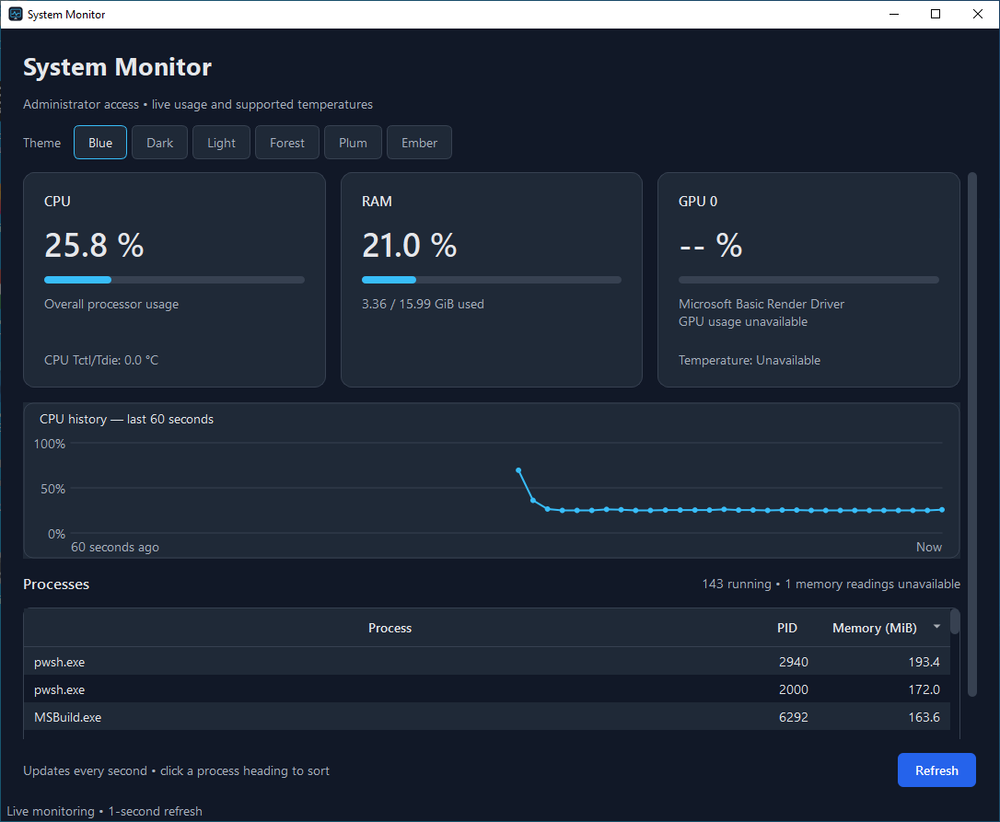
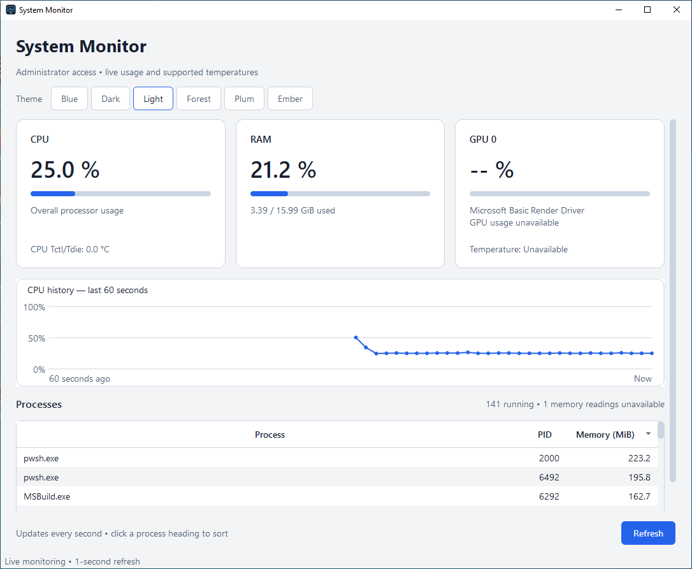
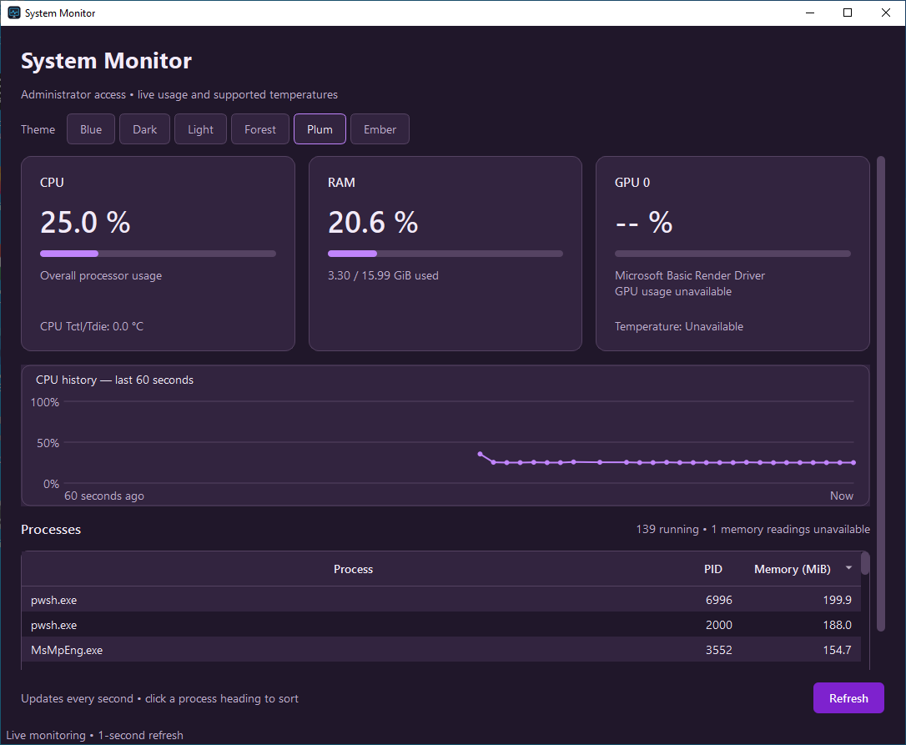

# System Monitor

[](https://github.com/aalatraqchi/System-Monitor/actions/workflows/windows-build.yml)
[](LICENSE)

A native Windows desktop system monitor built with C++17 and Qt 6 Widgets.

System Monitor shows live CPU, memory and GPU usage, CPU and GPU temperatures, a rolling CPU history graph and a sortable process list. Slow collectors run on a background worker thread, so the interface stays responsive while it refreshes every second.



## Features

- **Live usage:** CPU and RAM usage from Windows system counters, refreshed every second.
- **Per-GPU dashboard:** Usage for each hardware GPU from Windows GPU Engine performance counters, with the busiest engine (3D, video encode, compute and so on) named on each card.
- **Temperatures:** CPU package and GPU core temperatures through a small LibreHardwareMonitor helper process, with clear "Unavailable" states and reasons instead of misleading zeros.
- **CPU history graph:** A 60-second rolling graph drawn with QPainter, with gaps for missing readings and correct spacing for late timer ticks.
- **Process table:** Sortable by name, PID and memory, keeping selection and scroll position across refreshes.
- **Background collection:** Process, GPU and temperature sampling runs on a worker `QThread` with request coalescing, cancellation and clean shutdown.
- **Themes:** Six color themes (Blue, Dark, Light, Forest, Plum, Ember), remembered between launches.
- **Automated testing:** 9 CTest suites covering CPU and GPU arithmetic, process collection and sorting, history retention, worker lifecycle, the temperature helper protocol, theme persistence and application startup, plus a self-test for the helper's sensor selection.

## Tech Stack

- **Application:** C++17, Qt 6 Widgets, Win32 APIs (PDH, DXGI, PSAPI)
- **Temperature helper:** C# / .NET 8, LibreHardwareMonitorLib
- **Build:** CMake, Ninja or Visual Studio, PowerShell build scripts
- **Testing:** CTest
- **CI:** GitHub Actions on Windows (MSVC, Qt 6.8)

## Screenshots

| Light theme | Plum theme |
| --- | --- |
|  |  |

## Getting Started

Requirements: Windows 10 or 11 (x64), Qt 6 with a MinGW or MSVC kit (tested with Qt 6.8 and 6.12), and CMake. The temperature helper also needs the .NET 8 SDK to build.

With the Qt online installer's default layout (`C:\Qt`), build and run from PowerShell:

```powershell
powershell -ExecutionPolicy Bypass -File .\build.ps1
powershell -ExecutionPolicy Bypass -File .\build-temperatures.ps1
.\build\SystemMonitor.exe
```

You can also open `CMakeLists.txt` in Qt Creator. See [Setup Instructions](docs/SETUP.md) for other Qt locations, Visual Studio builds and enabling CPU temperatures.

## Testing

After building, run the test suite with CTest:

```powershell
ctest --test-dir build --output-on-failure
```

If `ctest` is not on your `PATH`, use the copy that ships with Qt, such as `C:\Qt\Tools\CMake_64\bin\ctest.exe`.

Every pull request and push to `main` is built and tested on a GitHub-hosted Windows runner. Tests that need live hardware, such as GPU counters, accept unavailable hardware there and still check the calculation logic.

## Current Scope

- Windows only. It reads Windows performance counters and Win32 APIs directly.
- CPU temperatures need administrator access and, on many systems, the signed PawnIO driver. The app never installs drivers or requests elevation by itself; without them it still shows usage and GPU temperature.
- There is no installer. The build scripts produce a runnable folder, and an optional script creates Start menu and desktop shortcuts.

## Documentation

- [Setup Instructions](docs/SETUP.md): prerequisites, building, temperature helper and shortcuts
- [Architecture](docs/ARCHITECTURE.md): code layout, threading model and design decisions
- [Measurements](docs/MEASUREMENTS.md): how CPU, memory, GPU and temperature readings are calculated
- [Development](docs/DEVELOPMENT.md): branch workflow, CI and conventions

## License

[MIT](LICENSE). Third-party components are listed in [THIRD-PARTY-NOTICES.md](THIRD-PARTY-NOTICES.md).
