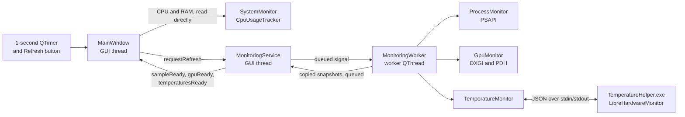

# Architecture

## Data flow



## Code layout

```text
src/
├── main.cpp                       Starts Qt, opens the window, handles --smoke-test
├── MainWindow                     Builds the UI and shows every reading
├── MetricCard                     Shared CPU, RAM and GPU card layout
├── AppTheme                       Six palettes and style sheets, saved with QSettings
├── WindowsAccess                  Checks whether the process is elevated (never requests it)
├── SystemMonitor, SystemSnapshot  CPU times and physical memory from Win32
├── CpuUsageTracker                CPU percentage from consecutive counter samples
├── CpuHistory, CpuHistoryGraph    Timestamped 60-second history and its QPainter graph
├── ProcessMonitor                 Process snapshots with RAII handle cleanup
├── ProcessTableModel              Table model, plus ProcessSortModel for numeric sorting
├── GpuMonitor                     DXGI adapter discovery and PDH GPU Engine counters
├── GpuUsageAggregator             Combines per-process engine counters into per-GPU usage
├── GpuDashboard                   One card per hardware GPU
├── TemperatureMonitor             Runs and talks to the helper process
├── TemperatureSnapshot            Validates readings and matches sensors to GPU cards
└── MonitoringService              Worker thread that owns the slow collectors
helpers/TemperatureHelper/         C# bridge to LibreHardwareMonitor
tests/                             One CTest executable per area
resources/                         App icon and Qt resource files
```

Qt owns child widgets through their parents, and layouts handle resizing. Collection classes do not depend on widgets, so the tests use them directly.

## Threading model

`MonitoringService` lives on the GUI thread. It owns a `QThread` and a `MonitoringWorker` that lives on that thread, and the two talk only through queued signals carrying copied snapshots. `MainWindow` is the only code that touches widgets.

- **Requests:** Startup, the one-second timer and the Refresh button each request a scan. If one is already pending or running, the request is ignored and the next timer tick tries again.
- **Failures:** A failed scan keeps the last process table. Missing GPU or temperature data shows as Unavailable.
- **Shutdown:** On exit the service requests interruption, quits the worker's event loop and waits for the current scan to finish. The process collector checks for cancellation between processes, and Windows calls already in progress finish normally. Handles close through RAII, and Qt deletes the worker when the thread finishes. Threads are never forcibly terminated.

CPU and RAM reads are fast, so they stay on the GUI thread along with graph updates.

## Temperature helper

LibreHardwareMonitor is a .NET library, so temperatures come from a separate helper process instead of being linked into the C++ app.

- The helper stays running and answers each `sample` request on stdin with one JSON line on stdout.
- Each request has a 2.5-second timeout and can be cancelled. After a failure the app waits 30 seconds before starting the helper again.
- Closing the app closes the helper.
- If the helper is missing, crashes or times out, the rest of the app keeps working.
- The helper enables only CPU and GPU sensors. It never installs drivers or requests elevation.

## Design decisions

- **Native APIs, no vendor SDKs.** GPU usage comes from the same Windows GPU Engine counters that Task Manager uses, so it works on NVIDIA, AMD and Intel GPUs without extra runtimes.
- **Unavailable instead of zero.** Every reading is an `std::optional`. Missing, invalid or out-of-range values show as Unavailable with a reason on hover, never as 0% or 0 °C.
- **Injected collectors for testing.** `MonitoringService` takes its process, GPU and temperature samplers as constructor arguments, so tests can substitute slow, failing or fake collectors and check threading, coalescing and cancellation.
- **No chart library.** The CPU graph is a small `QPainter` widget, which keeps the dependency list to Qt Widgets.
- **Stable theme IDs.** Saved themes use IDs such as `blue` rather than tab positions, so reordering tabs does not change anyone's saved theme.
